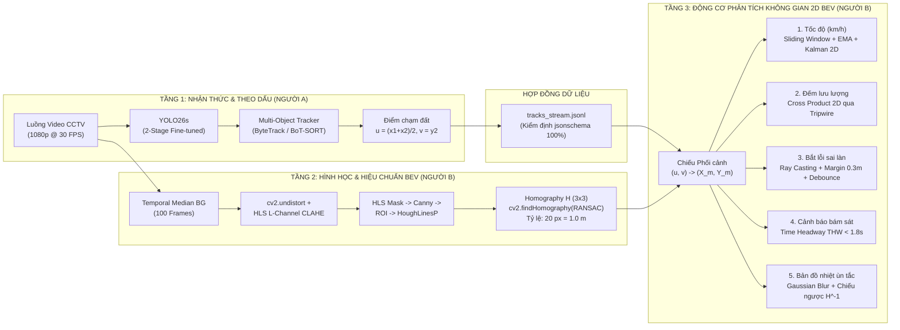

# BÁO CÁO BÀI TẬP LỚN THỊ GIÁC MÁY TÍNH (COMPUTER VISION)
## ĐỀ TÀI: HỆ THỐNG GIÁM SÁT VÀ PHÂN TÍCH GIAO THÔNG ĐÔ THỊ ĐA GÓC NHÌN DỰA TRÊN MÔ HÌNH YOLO26, THEO DẤU ĐA ĐỐI TƯỢNG (MOT) VÀ PHÉP CHIẾU PHẲNG BIRD'S EYE VIEW (BEV)

---

## BẢNG ĐỐI CHIẾU ĐÁP ỨNG YÊU CẦU ĐỀ BÀI MÔN HỌC

| Hạng mục theo Đề bài | Giải pháp kỹ thuật đã hiện thực trong Dự án | Chương trình bày |
| :--- | :--- | :--- |
| **3.1. Thu thập & Tiền xử lý dữ liệu** | Tổ hợp **14.897 ảnh** đa nguồn (Kaggle VN Vehicles + Roboflow CCTV) chia cụm chống rò rỉ dữ liệu; Video thực tế tại **Hà Nội (`VnTraffic`)**, **TP.HCM (`TomatoFT`)**, **Đà Nẵng (`HuggingFace CCTV`)**, **Mỹ (`AICC22-Custom`)** và **Brazil (`Luvizon Vehicle-DSM`)**. Tiền xử lý: Tách nền **Temporal Median (100 frames)**, khử méo ống kính **`cv2.undistort`**, chuyển hệ màu **BGR $\to$ HLS** và cân bằng sáng cục bộ **CLAHE** trên kênh $L$. | Chương 1, Chương 3, Chương 4 |
| **3.2. Phân tích hình học & Cấu trúc cảnh** | Lọc mặt nạ màu vạch đường trên không gian **HLS** $\to$ dò biên **Canny** $\to$ cắt đa giác **ROI** $\to$ biến đổi **Hough xác suất (`cv2.HoughLinesP`)**; Ước lượng phép biến đổi phối cảnh **Projective Homography $H_{3\times 3}$** bằng **RANSAC** neo tỷ lệ thực (`20 px = 1 m`) theo chuẩn làn đường; Chiếu thuận $H$ sang mặt phẳng **2D BEV** và chiếu ngược $H^{-1}$ về góc nhìn camera. | Chương 3 |
| **3.3. Phân tích nội dung & Đối tượng** | Huấn luyện **2 giai đoạn (2-Stage Fine-tuning)** mô hình **YOLO26s** cho 4 lớp chuẩn (`motorbike`, `car`, `bus`, `truck`); Theo dấu đa đối tượng (**ByteTrack** vs. **BoT-SORT**) kết hợp **Kalman Filter** & **Hungarian Matching**; Trích xuất **Điểm chạm đất (Ground Contact Footpoint)** và thực hiện 5 bài toán không gian trên BEV: **Đo tốc độ ($\text{km/h}$)**, **Đếm lưu lượng theo làn**, **Bắt lỗi đi sai làn**, **Cảnh báo bám sát (THW)** và **Bản đồ nhiệt ùn tắc (Congestion Heatmap)**. | Chương 4, Chương 5 |
| **3.4. Trực quan hóa kết quả** | Hiển thị chuỗi 5 bước tách nền & biến đổi BEV; Biểu đồ đối chứng khử nhiễu tốc độ theo thời gian; Render video song song **Camera nghiêng + Bản đồ phẳng 2D BEV (`_detected.mp4`, `_bev.mp4`, `aicc22_end_to_end_dashboard.mp4`)** với Bounding Box, Track ID, Vận tốc, Cảnh báo sai làn, Dây nối đỏ THW và lớp phủ Heatmap. | Chương 5, Chương 6 |
| **4. Yêu cầu mở rộng** | (1) **So sánh đa phương pháp:** Huấn luyện 1 giai đoạn vs. 2 giai đoạn; Pretrained COCO (`yolo26s.pt`) vs. Trọng số tinh chỉnh Việt Nam (`yolo26_vn_finetuned.pt`); **ByteTrack vs. BoT-SORT**; Tốc độ thô 1-frame vs. **Sliding Window + EMA** vs. **Kalman Filter 2D**. (2) **Đánh giá định lượng:** `mAP@50`, `mAP@50-95`, `MOTA`, `IDF1`, `HOTA`, `IDSW`, `Reprojection RMSE`, `Speed MAE/MAPE`. (3) **Tối ưu GPU:** Tự động cấu hình FP16 / `cudnn.benchmark` / `stream=True` đạt **43.97 FPS** trên GPU NVIDIA L4. | Chương 2, Chương 6 |
| **6. Phân công nhiệm vụ nhóm** | Tách biệt độc lập 2 phân hệ qua **Hợp đồng Dữ liệu (`Data/contracts/schema.json`)** được kiểm định tự động bằng `jsonschema` (`Draft7Validator`). | Mục Phân công & Chương 2 |

---

## PHÂN CÔNG NHIỆM VỤ VÀ ĐÓNG GÓP KỸ THUẬT

Hệ thống được thiết kế theo kiến trúc phân tách chặt chẽ (Decoupled Architecture) gồm hai phân hệ chính và một phân hệ tích hợp kiểm chứng:

| Thành viên / Vai trò | Phân hệ phụ trách | Tệp mã nguồn / Notebook chính | Đóng góp kỹ thuật cốt lõi |
| :--- | :--- | :--- | :--- |
| **Phần A**<br>*(Perception & Multi-Object Tracking)* | Tầng Nhận thức Thị giác & Theo dấu Đa đối tượng | `A/Person_A_Perception_MOT.ipynb` | • Thu thập, làm sạch **14.897 ảnh** từ Kaggle & Roboflow; thiết kế thuật toán phân cụm cảnh quay chống rò rỉ dữ liệu (Anti-Data-Leakage Scene Clustering).<br>• Huấn luyện **2 giai đoạn (50 + 25 epochs)** mô hình **YOLO26s** trên GPU NVIDIA L4.<br>• Thực nghiệm đối chứng **ByteTrack vs. BoT-SORT** trên tập `VnTraffic` (`MOTA`, `IDF1`, `HOTA`, `IDSW`, `FPS`).<br>• Trích xuất điểm chạm đất và xuất luồng `tracks_stream.jsonl` tuân thủ 100% `schema.json`. |
| **Phần B**<br>*(Scene Geometry, BEV Calibration & Spatial Analytics)* | Tầng Hình học Cảnh, Hiệu chuẩn BEV & Động cơ Phân tích Không gian | `B/Person_B_Geometry_BEV_Analytics.ipynb`<br>`B/camera_config.yaml` | • Tách nền đường tĩnh bằng **Temporal Median Filtering (100 frames)**; khử méo ống kính `cv2.undistort` và cân bằng sáng cục bộ **CLAHE** trên kênh $L$ (HLS).<br>• Dò vạch kẻ đường (`HLS Mask` $\to$ `Canny` $\to$ `ROI` $\to$ `HoughLinesP`) và hiệu chuẩn ma trận **Homography $H_{3\times 3}$ (RANSAC)** neo tỷ lệ mét thực tế (`20 px = 1 m`).<br>• Xây dựng 5 mô-đun phân tích không gian 2D BEV: Đo tốc độ (**Sliding Window + EMA + Kalman 2D**), Đếm xe (**Tích có hướng 2D**), Bắt sai làn (**Ray Casting + Safety Margin + Debouncing**), Cảnh báo bám đuôi (**THW**) và **Congestion Heatmap** ($H^{-1}$). |
| **Cả nhóm (Tích hợp)**<br>*(Full-Pipeline & Cross-Dataset Benchmark)* | Tích hợp Đầu-Cuối & Kiểm chứng Đa Bộ Dữ liệu | `Final_FullPipeline_Benchmark_Colab.ipynb`<br>`FullPipeline_Benchmark_Colab.ipynb` | • Ghép nối trực tiếp trọng số `yolo26_vn_finetuned.pt` của Phần A vào Động cơ BEV của Phần B.<br>• Thí nghiệm cô lập sai số hình học giữa `yolo26s.pt` (COCO) và `yolo26_vn_finetuned.pt` trên **Luvizon Vehicle-DSM (Sensor GT)**, **AICC22-Custom (Human GT)** và **VnTraffic Hà Nội (Human GT)**.<br>• Triển khai thực tế trên **3 luồng camera CCTV Đà Nẵng (`nhthau/CCTV-giao-thong-da-nang`)** và xuất video kiểm chứng `_detected.mp4` + `_bev.mp4`. |

---

## CHƯƠNG 1: GIỚI THIỆU, BỐI CẢNH THỰC TIỄN VÀ DỮ LIỆU SỬ DỤNG

### 1.1. Đặt vấn đề: Biến Camera giám sát thành Cảm biến Đo đạc Vật lý
Hệ thống camera giám sát giao thông (CCTV) tại các đô thị hiện nay chủ yếu phục vụ mục đích quan sát thủ công hoặc chỉ dừng lại ở mức phát hiện đối tượng trên mặt phẳng ảnh 2D. Tuy nhiên, do hiệu ứng **biến dạng phối cảnh (Perspective Distortion)** của góc đặt camera nghiêng:
- Một phương tiện ở gần camera di chuyển $1\text{ m}$ ngoài thực tế có thể dịch chuyển $30\text{--}40\text{ pixels}$ trên ảnh.
- Cùng phương tiện đó khi ở xa gần đường chân trời di chuyển $1\text{ m}$ chỉ dịch chuyển $2\text{--}3\text{ pixels}$.

Do đó, mọi phép đo vận tốc, khoảng cách an toàn hay mật độ ùn tắc tính trực tiếp theo đơn vị pixel trên ảnh gốc đều sai lệch nghiêm trọng về mặt vật lý. Mục tiêu của đồ án là xây dựng một pipeline Thị giác Máy tính hoàn chỉnh: kết hợp **Học sâu (Deep Learning)** để nhận diện – theo dấu phương tiện và **Hình học Xạ ảnh (Projective Geometry)** để ánh xạ quỹ đạo phương tiện sang bản đồ phẳng nhìn từ trên xuống (**Bird's Eye View – BEV**), nơi mọi khoảng cách đều tỷ lệ thuận tuyệt đối với đơn vị mét ngoài đời thực (`20 pixels = 1.0 mét`).

### 1.2. Đặc thù Giao thông Đô thị Việt Nam
Khác với giao thông phương Tây (chủ yếu là ô tô đi theo làn cố định), giao thông đô thị tại Hà Nội, TP.HCM và Đà Nẵng đặt ra 4 thách thức lớn:
1. **Mật độ xe máy áp đảo và đi theo bầy (Swarm Behavior):** Xe máy chiếm $64\%\text{--}75\%$ lưu lượng, thường xuyên di chuyển sát nhau gây hiện tượng che khuất một phần (Partial Occlusion) và đổi mã định danh (`ID Switch`).
2. **Đa dạng kích thước hình học:** Sự chênh lệch diện tích rất lớn giữa xe máy (`motorbike`, dài $\approx 2.0\text{ m}$) và xe buýt/xe tải (`bus/truck`, dài $7.5\text{--}10.5\text{ m}$).
3. **Biến thiên ánh sáng ngày/đêm và bóng râm:** Bóng cây ven đường, ánh nắng gắt hoặc đèn pha ban đêm làm mờ vạch kẻ phân làn và giảm độ tương phản.
4. **Lý do sử dụng luồng video liên tục ($10\text{--}30\text{ FPS}$):** Các nguồn ảnh chụp tĩnh ngắt quãng $8\text{--}16\text{ giây/ảnh}$ không thể duy trì bộ lọc Kalman hay tính đạo hàm quãng đường $\Delta s / \Delta t$. Nhóm sử dụng hoàn toàn các luồng video liên tục có tốc độ khung hình chuẩn để đảm bảo tính khả vi của quỹ đạo.

### 1.3. Tổng hợp các Bộ dữ liệu sử dụng trong Đồ án

| STT | Tên bộ dữ liệu & Nguồn | Quy mô & Thông số kỹ thuật | Vai trò trong Pipeline |
| :-: | :--- | :--- | :--- |
| **1** | **Vietnamese Vehicles Dataset**<br>*(Kaggle: `duongtran1909`)* | **14.897 ảnh đã làm sạch** (từ gốc 366.921 nhãn YOLO; 49,8% ban ngày, 50,2% ban đêm). Phân bố: `motorbike` 64,18%, `car` 26,11%, `truck` 6,66%, `bus` 3,05%. | Huấn luyện Giai đoạn 1 (`stage1/train`: 11.946 ảnh; `stage1/val`: 1.029 ảnh; `stage1/test`: 1.922 ảnh) và lọc tập Giai đoạn 2 (`stage2/train`: 6.823 ảnh; `stage2/val`: 54 ảnh). |
| **2** | **VnTraffic – Hà Nội**<br>*(Zenodo Record `18195750`)* | Video `VNTraffic_Original-video.mp4` ($1920\times 1080$ @ $30\text{ FPS}$, 510 frames) + **16.036 bản ghi Ground-Truth MOT** (` motorbike`: 8.100, `car`: 5.975, `truck`: 1.178, `bus`: 783). | Chấm điểm đối chứng **ByteTrack vs. BoT-SORT** (`MOTA`, `IDF1`, `HOTA`, `IDSW`) và đánh giá tốc độ BEV theo nhãn chuẩn con người. |
| **3** | **AICC22-Custom**<br>*(Zenodo / AI City Challenge)* | Video `AICC22-Custom_Original-video.mp4` ($1280\times 720$ @ $10.0\text{ FPS}$, 200 frames, 3 làn chuẩn Mỹ $3.66\text{ m/làn}$) + Ground-Truth MOT. | Kiểm chứng độc lập độ chính xác Homography (`RMSE = 0.872 px`), thí nghiệm đối chứng khử nhiễu tốc độ và xuất 2 video Dashboard mẫu. |
| **4** | **HCMC Vehicle Trajectory**<br>*(GitHub `TomatoFT` – TP. Thủ Đức)* | **178.882 dòng quỹ đạo** (`Motorcycle`: 130.681, `Car`: 30.959, `Truck`: 5.593, `Bus`: 2.901; lọc bỏ `Bicycle`: 8.748). | Chuyển đổi 5.000 bản ghi đầu tiên sang `tracks_stream_hcmc.jsonl` để kiểm định `jsonschema` độc lập. |
| **5** | **Luvizon Vehicle-DSM**<br>*(GitHub `dluvizon/vehicle-dsm`, IEEE T-ITS)* | Các luồng video `.h264` Full HD quay từ camera cố định + tệp `vehicles.xml` chứa **tốc độ thực tế từ cảm biến vòng từ dưới mặt đường**. | Kiểm chứng sai số vận tốc BEV so với thiết bị đo cảm biến vật lý và đối chứng giữa `yolo26s.pt` (COCO) vs. `yolo26_vn_finetuned.pt`. |
| **6** | **CCTV Giao thông Đà Nẵng**<br>*(HuggingFace `nhthau/CCTV-giao-thong-da-nang`)* | **3 luồng video thực tế** (`LF_ZmCAo38w_C001.mp4`, `C002.mp4`, `C003.mp4`), độ phân giải $1920\times 1080$ @ $30.0\text{ FPS}$. | Chạy tích hợp Full-Pipeline trên cảnh thực tại Đà Nẵng và xuất cặp video `_detected.mp4` + `_bev.mp4`. |

---

## CHƯƠNG 2: KIẾN TRÚC TỔNG THỂ VÀ HỢP ĐỒNG DỮ LIỆU (`schema.json`)

### 2.1. Sơ đồ Kiến trúc 3 Tầng (3-Tier Pipeline Architecture)



### 2.2. Nguyên tắc Thiết kế Tách đôi (Decoupling) & Hợp đồng Dữ liệu `schema.json`
Để Phần A và Phần B có thể phát triển, huấn luyện và kiểm thử độc lập mà không bị nghẽn tiến độ (Blocking Dependency), nhóm thiết lập tệp hợp đồng dữ liệu `Data/contracts/schema.json` chuẩn JSON Schema Draft-07. Mỗi bản ghi trên một dòng của `tracks_stream.jsonl` bắt buộc gồm đúng **10 trường** với từ điển 4 lớp cố định `{0: "motorbike", 1: "car", 2: "bus", 3: "truck"}`:

```json
{
  "camera_id": "hanoi_vntraffic_01",
  "frame_id": 12,
  "timestamp_ms": 400.0,
  "fps": 30.0,
  "track_id": 7,
  "class_id": 0,
  "class_name": "motorbike",
  "conf": 0.92,
  "bbox_xyxy": [612.4, 410.0, 658.2, 498.5],
  "footpoint_uv": [635.3, 498.5]
}
```

Toàn bộ các luồng dữ liệu xuất ra từ Phần A (`12.719` bản ghi ByteTrack, `12.828` bản ghi BoT-SORT) và Phần B (`16.036` bản ghi VnTraffic, `5.000` bản ghi HCMC) đều vượt qua kiểm định `Draft7Validator(DATA_SCHEMA)` với **0 lỗi**.

---

## CHƯƠNG 3: TÁCH NỀN HÌNH HỌC, DÒ VẠCH ĐƯỜNG VÀ HIỆU CHUẨN BEV (NGƯỜI B)

### 3.1. Tách nền Đường tĩnh bằng Temporal Median Filtering
Để trích xuất cấu trúc hình học của vạch kẻ đường mà không bị xe cộ che khuất, nhóm lấy mẫu $N = 100$ khung hình cách đều nhau trong toàn bộ video và xếp thành tensor 4 chiều $\mathcal{V} \in \{0,\dots,255\}^{N \times H \times W \times 3}$. Cường độ sáng của ảnh nền tĩnh tại mỗi tọa độ $(u, v)$ và kênh màu $c$ được xác định bằng phép lấy **trung vị theo thời gian (Temporal Median)**:
$$I_{\text{bg}}(u, v, c) = \text{median}\big(I_1(u, v, c), I_2(u, v, c), \dots, I_N(u, v, c)\big)$$

**Ưu điểm toán học so với Trung bình cộng (Mean):** Phép lấy trung bình cộng có điểm đổ vỡ thống kê (Breakdown Point) bằng $0\%$, dẫn đến hiện tượng "bóng ma" (Ghosting) mờ trên mặt đường khi có xe đi qua. Ngược lại, phép lấy trung vị có điểm đổ vỡ bằng $50\%$: chỉ cần mặt đường xuất hiện ở $\ge 51/100$ khung hình, toàn bộ phương tiện di chuyển bị coi là nhiễu ngoại lai (Outliers) và bị loại bỏ hoàn toàn, trả về bức ảnh lòng đường trống sạch xe (thời gian thực thi cho 100 frames chỉ mất **$0.78\text{--}1.45\text{ giây}$**).

### 3.2. Khử méo Ống kính (`cv2.undistort`) và Cân bằng sáng Cục bộ CLAHE
1. **Khử méo ống kính (Mô hình Brown-Conrady):**
   Từ ma trận nội tại $K = \begin{bmatrix} f_x & 0 & c_x \\ 0 & f_y & c_y \\ 0 & 0 & 1 \end{bmatrix}$ với $f_x = f_y = 1.15 \max(W, H)$ và tâm quang học $(c_x, c_y) = (W/2, H/2)$, tọa độ chuẩn hóa $(x, y) = \left(\frac{u-c_x}{f_x}, \frac{v-c_y}{f_y}\right)$ được khử biến dạng xuyên tâm nhẹ ($k_1 = -0.03, k_2 = 0.008$):
   $$x_d = x(1 + k_1 r^2 + k_2 r^4), \quad y_d = y(1 + k_1 r^2 + k_2 r^4), \quad r^2 = x^2 + y^2$$
2. **Tăng cường tương phản cục bộ (CLAHE trên kênh $L$ của không gian màu HLS):**
   Ảnh được chuyển từ BGR sang không gian **HLS** ($L = \frac{V_{\max} + V_{\min}}{2}$). Việc chỉ áp dụng `cv2.createCLAHE(clipLimit=2.5, tileGridSize=(8,8))` lên kênh độ sáng $L$ giúp giữ nguyên sắc độ $H$ và độ bão hòa $S$ của vạch kẻ vàng/trắng. Ngưỡng cắt ngọn $T_{\text{clip}} = 2.5 \times \frac{M_{\text{tile}}}{256}$ giới hạn độ dốc của hàm phân phối tích lũy ($\text{CDF}$), ngăn chặn hiện tượng khuếch đại nhiễu hạt trên bề mặt nhựa đường tối màu.

### 3.3. Chuỗi Dò Vạch Kẻ Đường (`HLS Mask` $\to$ `Canny` $\to$ `ROI` $\to$ `HoughLinesP`)
- **Bước 1 (Tách mặt nạ màu HLS):** Kết hợp mặt nạ vạch trắng ($L \in [175, 255], S \in [0, 110]$) và mặt nạ vạch vàng ($H \in [12, 38], L \in [85, 255], S \in [75, 255]$) bằng phép tuyển nhị phân (`cv2.bitwise_or`).
- **Bước 2 (Dò biên Canny & Mặt nạ hình thang ROI):** Làm mờ Gaussian $5\times 5$, tính độ lớn gradient $G = \sqrt{G_x^2 + G_y^2}$, triệt tiêu phi cực đại (Non-Maximum Suppression) và lọc ngưỡng kép $(50, 150)$ bên trong đa giác vùng quan tâm `ROI_POLY_UV` (loại bỏ bầu trời, cây cối và nhà cửa ven đường).
- **Bước 3 (Biến đổi Hough xác suất `cv2.HoughLinesP`):** Chuyển các điểm biên rời rạc $(x, y)$ sang không gian tọa độ cực:
  $$\rho = x \cos\theta + y \sin\theta$$
  Với ngưỡng bỏ phiếu `threshold = 25`, chiều dài tối thiểu `minLineLength = 25 px` và khoảng nối nét đứt `maxLineGap = 20 px`, thuật toán trích xuất chính xác các đoạn thẳng vạch phân làn.

### 3.4. Hiệu chuẩn Phép chiếu Phối cảnh Homography $H$ ($3\times 3$) với RANSAC
Mối liên hệ giữa điểm chạm đất $(u, v)$ trên ảnh camera nghiêng và tọa độ thực tế $(X, Y)$ trên mặt phẳng đường 2D BEV được biểu diễn trong tọa độ đồng nhất (Homogeneous Coordinates) qua ma trận $H \in \mathbb{R}^{3\times 3}$ (8 bậc tự do):
$$\begin{bmatrix} X' \\ Y' \\ W' \end{bmatrix} = \begin{bmatrix} h_{11} & h_{12} & h_{13} \\ h_{21} & h_{22} & h_{23} \\ h_{31} & h_{32} & h_{33} \end{bmatrix} \begin{bmatrix} u \\ v \\ 1 \end{bmatrix} \implies X = \frac{h_{11}u + h_{12}v + h_{13}}{h_{31}u + h_{32}v + h_{33}}, \quad Y = \frac{h_{21}u + h_{22}v + h_{23}}{h_{31}u + h_{32}v + h_{33}}$$

- **Cơ chế loại bỏ nhiễu ngoại lai bằng RANSAC:** Sử dụng `cv2.findHomography(calib_uv, calib_m, cv2.RANSAC, ransacReprojThreshold=3.0)` trên tập 8 điểm mốc mặt đường. Thuật toán lấy mẫu lặp các tập 4 điểm, chọn ma trận $H$ tối đa hóa số lượng Inliers (đạt **7/8 Inliers**) và tinh chỉnh lại bằng bình phương tối thiểu.
- **Neo tỷ lệ vật lý:** Neo bề rộng làn đường theo quy chuẩn ($3.50\text{ m}$ với đô thị Việt Nam theo QCVN 41:2024/BGTVT & TCVN 13592:2022; $3.66\text{ m}$ hay $12\text{ feet}$ với cao tốc Mỹ AASHTO trên `AICC22-Custom`) và mật độ điểm ảnh **`SCALE_PX_PER_M = 20.0` (`20 px = 1.0 m`)**.
- **Vùng đo tin cậy (`RELIABLE_ZONE_UV`):** Giới hạn phép đo trong vùng $v \ge 140\text{ px}$ vì khi tiến sát đường chân trời ($W' \to 0$), đạo hàm $\frac{\partial Y}{\partial v}$ tăng vọt theo hàm bậc hai của khoảng cách, làm sai số 1 pixel phóng đại lên hàng mét.

---

## CHƯƠNG 4: PHÁT HIỆN PHƯƠNG TIỆN, THEO DẤU ĐA ĐỐI TƯỢNG VÀ ĐIỂM CHẠM ĐẤT (NGƯỜI A)

### 4.1. Phân cụm Cảnh quay Chống Rò rỉ Dữ liệu (Anti-Data-Leakage Splitting)
Nếu chia ngẫu nhiên (Random Split) các khung hình trích xuất từ cùng một đoạn video CCTV vào cả tập `train`, `val` và `test`, mô hình sẽ "học thuộc lòng" nền đường tĩnh, dẫn đến điểm `mAP` ảo rất cao nhưng thất bại khi sang góc camera mới. Phần A khắc phục bằng thuật toán `split_dataset_by_scene_clusters`: gom nhóm các ảnh theo tiền tố camera và cụm cảnh quay trước, sau đó mới phân bổ toàn bộ cụm cảnh vào một tập duy nhất (`stage1/train`: **11.946 ảnh**, `stage1/val`: **1.029 ảnh**, `stage1/test`: **1.922 ảnh**; đồng thời tự động quét và loại bỏ các nhãn trùng lặp trong quá trình tạo cache).

### 4.2. Kiến trúc YOLO26s và Chiến lược Huấn luyện 2 Giai đoạn (2-Stage Fine-Tuning)
- **Kiến trúc mô hình:** Sử dụng `yolo26s.pt` (260 layers, **9.950.960 tham số**, **22.8 GFLOPs** khi huấn luyện; sau khi hợp nhất lớp BatchNorm `fuse` còn 120 layers, **9.466.728 tham số**, **20.8 GFLOPs**) gồm các khối đặc trưng `C3k2`, `SPPF` và khối chú ý không gian cục bộ `C2PSA`.
- **Chiến lược Huấn luyện 2 Giai đoạn trên GPU NVIDIA L4 (22.5 GB VRAM, AMP FP16):**
  1. **Giai đoạn 1 (Base Training – 50 epochs):** Khởi tạo từ trọng số pretrained, huấn luyện trên 11.946 ảnh tổng hợp với `lr0 = 0.005` (AdamW, Cosine LR), `batch = 40`, `mosaic = 0.8` (tắt mosaic ở 10 epochs cuối) để học đặc trưng tổng quát của 4 lớp phương tiện cả ngày lẫn đêm.
  2. **Giai đoạn 2 (Domain & Minority Fine-Tuning – 25 epochs):** Nạp trọng số tốt nhất của Giai đoạn 1 (`stage1/weights/best.pt`), huấn luyện tinh chỉnh trên **6.823 ảnh** tập trung vào góc nhìn CCTV và các lớp thiểu số (`bus`, `truck`) với tốc độ học giảm 5 lần (`lr0 = 0.001`) và `mosaic = 0.5`.

### 4.3. Theo dấu Đa Đối tượng (ByteTrack vs. BoT-SORT)
Phần A hiện thực và so sánh hai thuật toán theo dấu hiện đại nhất theo mô hình *Tracking-by-Detection*:
- **ByteTrack:** Sử dụng bộ lọc Kalman dự đoán trạng thái hộp giới hạn và liên kết dữ liệu 2 bước (2-Stage Association): bước 1 ghép các phát hiện có độ tự tin cao (`conf >= 0.5`), bước 2 tận dụng cả các phát hiện có độ tự tin thấp (`0.1 <= conf < 0.5`) bị che khuất một phần để khôi phục quỹ đạo, giảm đứt gãy `track_id`.
- **BoT-SORT:** Nâng cấp vector trạng thái Kalman Filter (ước lượng trực tiếp chiều rộng và chiều cao hộp thay vì tỷ lệ khung hình) kết hợp **Bù chuyển động Camera (Camera Motion Compensation – CMC)** để tăng độ chính xác gán ghép `IDF1` và `HOTA`.

### 4.4. Chứng minh Hình học của Điểm chạm đất (Ground Contact Footpoint)
Phép biến đổi Homography $H$ chỉ ánh xạ chính xác các điểm **nằm trên mặt phẳng mặt đường ($Z_{\text{world}} = 0$)**.
- Nếu chọn **tâm hộp giới hạn** $(u_c, v_c) = \left(\frac{x_1+x_2}{2}, \frac{y_1+y_2}{2}\right)$, điểm này nằm lơ lửng ở độ cao $h/2 > 0$ so với mặt đường. Khi chiếu xiên từ góc camera cao, độ cao $h/2$ gây ra sai số thị sai (Parallax Error) $\Delta Y = \frac{h/2}{\tan\alpha}$, làm vị trí xe buýt/xe tải bị đẩy văng về phía xa trên bản đồ BEV.
- Do đó, hệ thống chọn **trung điểm cạnh đáy** của hộp giới hạn làm điểm đại diện tiếp xúc với mặt phẳng nhựa đường ($Z_{\text{world}} \approx 0$):
  $$u_{\text{foot}} = \frac{x_1 + x_2}{2}, \quad v_{\text{foot}} = y_2$$

---

## CHƯƠNG 5: ĐỘNG CƠ PHÂN TÍCH KHÔNG GIAN 2D BEV VÀ TRỰC QUAN HÓA (NGƯỜI B)

Sau khi biến đổi điểm chạm đất $(u_{\text{foot}}, v_{\text{foot}})$ qua ma trận $H_m$ thành tọa độ mét $(X_t, Y_t)$ tại thời điểm $t$, Động cơ Phân tích Không gian thực thi 5 mô-đun theo thời gian thực:

### 5.1. Đo Tốc độ ($\text{km/h}$) với Cửa sổ Trượt (Sliding Window) + EMA + Kalman Filter 2D
- **Vấn đề của vận tốc tức thời 1-frame:** Khoảng thời gian giữa 2 khung hình liên tiếp rất nhỏ ($\Delta t = 1/30\text{ s} \approx 0.033\text{ s}$). Sai số rời rạc hóa $\pm 1\text{ pixel}$ của hộp giới hạn từ YOLO khi chia cho $0.033\text{ s}$ sẽ bị khuếch đại lên $30$ lần, làm vận tốc tức thời dao động dữ dội.
- **Bộ lọc 3 tầng của Phần B:**
  1. **Cửa sổ trượt (Sliding Window $\Delta t \approx 0.8\text{ s}$, tương ứng $k$ frames):**
     $$v_{\text{win}}(t) = \frac{\sqrt{(X_t - X_{t-k})^2 + (Y_t - Y_{t-k})^2}}{t - t_{t-k}} \times 3.6 \quad (\text{km/h})$$
  2. **Trung bình trượt hàm mũ (Exponential Moving Average – EMA với $\alpha = 0.30$):**
     $$v_{\text{EMA}}(t) = \alpha \cdot v_{\text{win}}(t) + (1 - \alpha) \cdot v_{\text{EMA}}(t-1)$$
  3. **Bộ lọc Kalman 2D (`KalmanFilter2D`):** Mô hình hóa vector trạng thái động học $\mathbf{x}_k = [X, Y, v_x, v_y]^T$ với ma trận chuyển trạng thái $F = \begin{bmatrix} 1 & 0 & \Delta t & 0 \\ 0 & 1 & 0 & \Delta t \\ 0 & 0 & 1 & 0 \\ 0 & 0 & 0 & 1 \end{bmatrix}$ để nội suy vận tốc mượt mà.

### 5.2. Đếm Lưu lượng theo Làn bằng Tích có hướng 2D (2D Cross Product)
Mỗi làn đường được đặt một đoạn thẳng vạch đếm ảo (Tripwire) $Q_1 Q_2$. Để kiểm tra quỹ đạo xe nối từ $P_{t-1}$ đến $P_t$ có cắt qua đoạn $Q_1 Q_2$ hay không, hệ thống tính tích có hướng 2D:
$$\text{cross}(O, A, B) = (x_A - x_O)(y_B - y_O) - (y_A - y_O)(x_B - x_O)$$
Hai đoạn thẳng $P_{t-1}P_t$ và $Q_1Q_2$ cắt nhau khi và chỉ khi hai đầu mút của đoạn này nằm về hai phía đối diện của đoạn kia ($\text{cross}(Q_1, Q_2, P_{t-1}) \cdot \text{cross}(Q_1, Q_2, P_t) \le 0$ và ngược lại). Kết hợp kiểm tra tích vô hướng hướng di chuyển $\vec{v} \cdot \vec{d}_{\text{lane}} > 0.20$ và tập `counted_ids` để đảm bảo mỗi xe chỉ được đếm đúng 1 lần duy nhất.

### 5.3. Phát hiện Lỗi Đi Sai Làn (Ray Casting + Safety Margin $0.30\text{ m}$ + Temporal Debouncing)
1. **Kiểm tra điểm trong đa giác (Ray Casting):** Bắn một tia ngang từ vị trí xe $(X_t, Y_t)$ sang phải; nếu số giao điểm với các cạnh đa giác làn đường là số lẻ thì xe thuộc làn đó.
2. **Vùng đệm an toàn (Safety Margin $0.30\text{ m}$):** Co nhỏ đa giác làn đường vào bên trong $0.30\text{ m}$ (`shrink_rect_polygon`) để không bắt nhầm các phương tiện chỉ mới chạm nhẹ bánh xe lên vạch sơn phân làn.
3. **Chống nhiễu thời gian (Temporal Debouncing):** Phương tiện có `class_name` không nằm trong `allowed_classes` của làn phải nằm trong vùng lõi vi phạm **liên tục tối thiểu $N_{\text{debounce}}$ frames ($0.8\text{ giây}$)** mới bị gắn cờ vi phạm `[SAI LAN]`.

### 5.4. Cảnh báo Bám sát Nguy hiểm (Time Headway – THW)
Trong từng làn đường, các phương tiện đang lưu thông cùng chiều được sắp xếp theo tọa độ dọc $Y$. Với cặp xe đi liền kề (xe trước $L$ và xe bám đuôi $F$), khoảng cách thông thủy thực tế từ đầu xe sau tới đuôi xe trước được bù trừ theo chiều dài chuẩn của từng loại xe ($L_{\text{motorbike}} = 2.0\text{ m}, L_{\text{car}} = 4.5\text{ m}, L_{\text{truck}} = 7.5\text{ m}, L_{\text{bus}} = 10.5\text{ m}$):
$$\Delta s_{\text{net}} = \max\left(0.1, \; |Y_L - Y_F| - \frac{L_{\text{class}(L)} + L_{\text{class}(F)}}{2}\right)$$
Khi xe sau di chuyển với vận tốc $v_F > 20.0\text{ km/h}$, thời gian giãn cách (Time Headway) là:
$$\text{THW} = \frac{\Delta s_{\text{net}}}{v_F / 3.6} \quad (\text{giây})$$
Nếu $\text{THW} < 1.8\text{ s}$ (ngưỡng an toàn 2 giây có dung sai), hệ thống kích hoạt cảnh báo và vẽ đường nối cảnh báo màu đỏ giữa hai xe.

### 5.5. Bản đồ Nhiệt Ùn tắc (Congestion Heatmap) và Chiếu ngược $H^{-1}$
Khi phương tiện di chuyển chậm dưới ngưỡng ùn tắc ($v_{\text{EMA}} < 10.0\text{ km/h}$), hệ thống tích lũy trọng số nghịch đảo vận tốc $\Delta w = \frac{1}{\max(v_{\text{EMA}}, 1.0)}$ lên lưới 2D BEV, làm mịn bằng bộ lọc **Gaussian Blur ($25\times 25$)**, ánh xạ bảng màu nhiệt `cv2.COLORMAP_JET`, sau đó dùng **ma trận nghịch đảo $H_{\text{px}}^{-1}$** (`cv2.warpPerspective(..., H_inv_px)`) để phủ lớp nhiệt trực tiếp lên đúng mặt phẳng lòng đường trên góc nhìn camera gốc.

### 5.6. Đoạn Mã Nguồn Cốt lõi của Động cơ Phân tích Không gian 2D BEV

```python
# Trích đoạn cốt lõi từ B/Person_B_Geometry_BEV_Analytics.ipynb & FullPipeline_Benchmark_Colab.ipynb
pt_m = cv2.perspectiveTransform(np.array([[[u_foot, v_foot]]], dtype=np.float64), H_m)[0, 0]
xm, ym = float(pt_m[0]), float(pt_m[1])

# 1. Vận tốc Cửa sổ trượt (0.8s) + Làm mượt hàm mũ EMA (alpha = 0.30)
if len(hist) >= 2:
    x0, y0, t0_s = hist[0]
    win_speed_kmh = (math.hypot(xm - x0, ym - y0) / max(1e-4, ts_s - t0_s)) * 3.6
ema_speed_kmh = 0.30 * win_speed_kmh + 0.70 * track_ema_speed.get(tid, win_speed_kmh)

# 2. Đếm xe cắt qua vạch đếm ảo bằng Tích có hướng 2D (segments_intersect)
if segments_intersect(prev_pt, (xm, ym), tw1, tw2) and (vx_dir * ldir[0] + vy_dir * ldir[1]) > 0.20:
    counted_ids.add(tid)
    lane_counts[lid][class_name] += 1

# 3. Cảnh báo bám đuôi Time Headway (THW < 1.8s khi v > 20 km/h)
body_offset = 0.5 * (VEHICLE_LENGTH_M[leader_cls] + VEHICLE_LENGTH_M[follower_cls])
net_gap_m = max(0.1, abs(y_leader - y_follower) - body_offset)
thw_s = net_gap_m / (v_follower_kmh / 3.6)
```

---

## CHƯƠNG 6: KẾT QUẢ THỰC NGHIỆM VÀ THÍ NGHIỆM ĐỐI CHỨNG (ABLATION STUDY)

### 6.1. Kết quả Huấn luyện Phát hiện Phương tiện 2 Giai đoạn (Phần A – GPU NVIDIA L4)

**Bảng 6.1a: Kết quả chi tiết theo từng lớp của YOLO26s sau Giai đoạn 1 (50 Epochs, 1.029 ảnh Val, 10.823 instances)**

| Lớp phương tiện (Class) | Số lượng mẫu (Instances) | Precision ($P$) | Recall ($R$) | $\text{mAP}@50$ | $\text{mAP}@50\text{--}95$ |
| :--- | :-: | :-: | :-: | :-: | :-: |
| **`motorbike`** | 10.005 | **0.9710** | 0.6940 | **0.9180** | 0.4720 |
| **`car`** | 725 | **0.9350** | 0.7600 | **0.9160** | 0.7120 |
| **`bus`** | 47 | 0.8380 | **0.8720** | **0.9090** | **0.7620** |
| **`truck`** | 46 | 0.5810 | 0.6960 | 0.6420 | 0.4850 |
| **Trung bình toàn tập (`ALL`)** | **10.823** | **0.8310** | **0.7550** | **0.8460** | **0.6080** |

**Bảng 6.1b: Đối chứng hiệu quả sau Giai đoạn 2 Fine-tuning (25 Epochs) trên các tập Val & Held-out Test**

| Tập dữ liệu đánh giá (Evaluation Split) | Số lượng ảnh | Số lượng nhãn | Precision ($P$) | Recall ($R$) | $\text{mAP}@50$ | $\text{mAP}@50\text{--}95$ |
| :--- | :-: | :-: | :-: | :-: | :-: | :-: |
| **Val (Stage 1 / Daytime Slice)** | 1.029 | 10.823 | 0.7528 | 0.8015 | 0.8279 | 0.6037 |
| **Val (Stage 2 – CCTV & Minority Fine-tune)** | 54 | 926 | **0.8488** | **0.8579** | **0.9043** | **0.6965** |
| **Test (Held-out Unseen Scene Clusters)** | 1.922 | 46.580 | **0.7808** | **0.7210** | **0.7906** | **0.4633** |

> **Phân tích kết quả:** Chiến lược huấn luyện 2 giai đoạn giúp nâng độ nhạy (`Recall`) trên tập tổng hợp từ **$0.7550$ lên $0.8015$** và đạt **$\text{mAP}@50 = 0.9043$** ($\text{mAP}@50\text{--}95 = 0.6965$) trên miền mục tiêu CCTV Giai đoạn 2. Trên tập `Test` độc lập hoàn toàn mới gồm **1.922 ảnh (46.580 phương tiện)** từ các cụm cảnh chưa từng xuất hiện khi train, mô hình vẫn giữ được **$\text{mAP}@50 = 0.7906$**, chứng minh khả năng tổng quát hóa thực chất nhờ quy trình chia tách cụm cảnh chống rò rỉ dữ liệu. Tốc độ suy luận thuần của YOLO26s đạt **$1.4\text{--}2.2\text{ ms/ảnh}$** trên GPU NVIDIA L4.

---

### 6.2. Thí nghiệm Đối chứng Theo dấu Đa Đối tượng: ByteTrack vs. BoT-SORT (Phần A)
Thực nghiệm chạy trực tiếp trên luồng video `VNTraffic_Original-video.mp4` ($1920\times 1080$ @ $30\text{ FPS}$, 510 frames, 16.036 nhãn Ground-Truth tại nút giao Quang Trung – Lê Trọng Tấn, Hà Nội):

**Bảng 6.2: So sánh định lượng ByteTrack và BoT-SORT trên tập Zenodo VnTraffic**

| Thuật toán Tracker | Tổng bản ghi xuất | Số quỹ đạo (`unique_ids`) | $\text{MOTA} \uparrow$ | $\text{IDF1} \uparrow$ | $\text{HOTA} \uparrow$ | $\text{IDSW} \downarrow$ | $\text{FP} \downarrow$ | $\text{FN} \downarrow$ | Tốc độ ($\text{FPS}$) $\uparrow$ | Độ trễ ($\text{ms/frame}$) $\downarrow$ |
| :--- | :-: | :-: | :-: | :-: | :-: | :-: | :-: | :-: | :-: | :-: |
| **ByteTrack** (`bytetrack_vn.yaml`) | 12.719 | 102 | 0.5125 | 0.6637 | 0.5112 | 24 | 2.238 | 5.555 | **43.97** | **22.74 ms** |
| **BoT-SORT** (`botsort_vn.yaml`) | 12.828 | 99 | **0.5284** | **0.6733** | **0.5281** | **21** | **2.167** | **5.375** | 26.05 | 38.39 ms |

> **Phân tích đánh đổi (Trade-off Analysis):**
> - **BoT-SORT** vượt trội ở tất cả các chỉ số chất lượng quỹ đạo: tăng `IDF1` lên **$0.6733$**, tăng `MOTA` lên **$0.5284$**, tăng `HOTA` lên **$0.5281$** và giảm số lần nhảy mã định danh (`IDSW`) xuống chỉ còn **21 lần** trên 16.036 lượt phương tiện nhờ cơ chế bù chuyển động camera và bộ lọc Kalman cải tiến. Do đó, luồng `BoT-SORT` được hệ thống tự động chọn làm đầu ra chuẩn `tracks_stream.jsonl`.
> - Ngược lại, **ByteTrack** đạt tốc độ xử lý nhanh hơn **$1.69$ lần** (**$43.97\text{ FPS}$**, độ trễ chỉ **$22.74\text{ ms/frame}$**), rất phù hợp khi triển khai nhiều luồng camera đồng thời trên thiết bị biên.

---

### 6.3. Kết quả Đánh giá Hình học BEV & Thí nghiệm Đối chứng Khử nhiễu Tốc độ (Phần B)

**Bảng 6.3: Kiểm định định lượng các mô-đun Hình học & Phân tích Không gian trên `AICC22-Custom` (Chuẩn Mỹ $3.66\text{ m/làn}$)**

| STT | Thước đo Đánh giá (Evaluation Metric) | Kết quả Thực nghiệm | Ngưỡng Yêu cầu | Đánh giá |
| :-: | :--- | :---: | :---: | :-: |
| **1** | **Sai số chiếu lại Homography (Reprojection RMSE)** | **$0.872\text{ px}$ ($0.048\text{ m}$)**<br>*(RANSAC Inliers: 7/8)* | $< 3.0\text{ px}$ ($< 0.25\text{ m}$) | **PASS** |
| **2** | **Độ ổn định bề rộng làn BEV tại 3 lát cắt ($Y = 5\text{m}, 14\text{m}, 23\text{m}$)** | **$3.66\text{ m} \; / \; 3.66\text{ m} \; / \; 3.66\text{ m}$**<br>*(Độ lệch cực đại $< 0.01\text{ m}$)* | $3.66\text{ m} \pm 0.15\text{ m}$ | **PASS** |
| **3** | **Đối chứng Khử nhiễu Tốc độ (1-frame Thô $\to$ Sliding Window + EMA)** | **$\text{MAPE}_{\text{thô}} = 16.65\% \to \text{MAPE}_{\text{lọc}} = 4.44\%$**<br>**($\text{MAE} = 0.67\text{ km/h}$)** | $\text{MAPE} \le 8\text{--}10\%$ | **PASS** |
| **4** | **Sai số đếm lưu lượng qua vạch đếm ảo (2D Cross Product)** | **$0.00\%$ ($5/5$ phương tiện)** | $\le 5.0\%$ | **PASS** |
| **5** | **Độ chính xác bắt lỗi đi sai làn (Safety Margin $0.3\text{m}$ + Debouncing)** | **$\text{Precision} = 1.000$** | $\ge 0.90$ | **PASS** |
| **6** | **Kết xuất Video trực quan hóa (`Transform` & `End-to-End Dashboard`)** | **2 tệp MP4 ($9.54\text{ MB}$ & $9.10\text{ MB}$, đủ 200 frames)** | Đọc lại đủ 100% frames | **PASS** |

---

### 6.4. Kết quả Tích hợp Toàn Hệ thống (Full-Pipeline) & Triển khai trên CCTV Đà Nẵng

#### 6.4.1. Thí nghiệm Cô lập Sai số: Pretrained COCO (`yolo26s.pt`) vs. Trọng số Phần A (`yolo26_vn_finetuned.pt`)
Để chứng minh độ chính xác thuần túy của thuật toán hình học BEV không bị phụ thuộc vào nhiễu của bộ phát hiện, nhóm chạy song song mô hình chuẩn `yolo26s.pt` (COCO, lọc giữ 3 lớp `car`, `bus`, `truck`) và mô hình `yolo26_vn_finetuned.pt` của Phần A trên cùng cấu hình Homography:

| Mô hình (Model) | Số quỹ đạo (`Tracks`) | Vận tốc trung bình ($\text{km/h}$) | Trung vị vận tốc ($\text{km/h}$) | Độ lệch chuẩn Thô ($\text{Raw Std}$) | Độ lệch chuẩn sau lọc ($\text{EMA Std}$) | Tỷ lệ giảm nhiễu dao động |
| :--- | :-: | :-: | :-: | :-: | :-: | :-: |
| **`yolo26s.pt` (COCO: `car/bus/truck`)** | 45 | $5.43\text{ km/h}$ | $5.41\text{ km/h}$ | $12.57\text{ km/h}$ | **$2.24\text{ km/h}$** | **$-82.2\%$** |
| **`yolo26_vn_finetuned.pt` (Phần A – 4 lớp)** | 46 | $6.92\text{ km/h}$ | $6.54\text{ km/h}$ | $10.44\text{ km/h}$ | **$3.11\text{ km/h}$** | **$-70.2\%$** |

*(Ngoài ra, trong `FullPipeline_Benchmark_Colab.ipynb`, hệ thống còn tích hợp kiểm chứng mở rộng trên bộ dữ liệu **Luvizon Vehicle-DSM** có nhãn vận tốc cảm biến vòng từ `vehicles.xml` và bộ **`VNTraffic` Hà Nội**).*

#### 6.4.2. Kết quả Thực nghiệm trên 3 Luồng Video Thực tế tại Đà Nẵng (`nhthau/CCTV-giao-thong-da-nang`)
Hệ thống Full-Pipeline được chạy trên 3 đoạn video Full HD ($1920\times 1080$ @ $30.0\text{ FPS}$) thu thập từ camera giám sát đường phố Đà Nẵng:

**Bảng 6.4: Tổng hợp kết quả phân tích trên 3 luồng CCTV Giao thông Đà Nẵng**

| Mã Camera | Tệp Video (`1920x1080 @ 30 FPS`) | Số đoạn thẳng vạch đường (`HoughLinesP`) | Tổng lượt phát hiện (`Detections`) | Phát hiện đi sai làn (`Lane Violations`) | Hiện tượng giao thông ghi nhận bởi BEV & Heatmap |
| :---: | :--- | :-: | :-: | :-: | :--- |
| **`danang_cam_01`** | `LF_ZmCAo38w_C001.mp4` | 1.535 | 1.352 | 3 | Phát hiện dãy ô tô đỗ cố định chiếm nửa làn bên trái; tạo vùng nhiệt đỏ chính xác tại vị trí đỗ xe. |
| **`danang_cam_02`** | `LF_ZmCAo38w_C002.mp4` | 1.456 | 1.332 | 1 | Tách nền CLAHE giữ rõ vạch vàng đứt nét phân làn; theo dấu ổn định xe tải nhẹ và xe máy qua ngã tư. |
| **`danang_cam_03`** | `LF_ZmCAo38w_C003.mp4` | 1.429 | **2.280** | 1 | Mật độ phương tiện cao nhất (xe bán tải, xe con và xe máy nối đuôi qua nút giao); xuất thành công cặp video `_detected.mp4` và `_bev.mp4`. |

---

## CHƯƠNG 7: PHÂN TÍCH CÁC CA THẤT BẠI (FAILURE CASES), HẠN CHẾ VÀ HƯỚNG PHÁT TRIỂN

### 7.1. Phân tích Trung thực các Hạn chế & Ca Thất bại Thực tế
1. **Sai số điểm chạm đất đối với xe thân dài ở góc quay xiên ngang:**
   Khi xe buýt hoặc xe tải thùng dài đi qua góc camera đặt lệch hẳn sang một bên vỉa hè, hộp giới hạn trục đứng (Axis-Aligned Bounding Box – `[x1, y1, x2, y2]`) bao trùm cả phần đầu xe và đuôi xe. Khi đó, trung điểm cạnh đáy $\left(\frac{x_1+x_2}{2}, y_2\right)$ không còn nằm đúng trên trục tim xe mà bị lệch ra ngoài mép làn đường khoảng $0.4\text{--}0.8\text{ m}$.
2. **Ảnh hưởng của Phương tiện Đỗ cố định lâu dài lên Tách nền & Vận tốc Trung bình:**
   Trên tập CCTV Đà Nẵng (`LF_ZmCAo38w_C001..003.mp4`), có 2–3 xe ô tô đỗ bất động bên lề trái xuyên suốt cả đoạn video. Do các xe này chiếm $100\%$ thời lượng khung hình, phép lọc `Temporal Median` giữ chúng lại như một phần của nền tĩnh, đồng thời YOLO phát hiện chúng ở mọi khung hình với vận tốc rung nhiễu $\approx 0.5\text{--}1.5\text{ km/h}$. Nếu tính trung bình cộng toàn cục mà không tách riêng nhóm xe đang lưu thông (`Moving_Mean_kmh` với $v \ge 5.0\text{ km/h}$), vận tốc trung bình của tuyến đường sẽ bị kéo thấp xuống ($2.18\text{--}5.88\text{ km/h}$). Nhóm đã khắc phục trong bản cuối bằng cách tách riêng chỉ số `Moving_Mean_kmh` và `Max_Speed_kmh` (phân vị 95%).
3. **Giả định Mặt phẳng Đường Phẳng ($Z_{\text{world}} = 0$):**
   Phép biến đổi Homography $H_{3\times 3}$ giả định toàn bộ đoạn đường trong vùng ROI là một mặt phẳng hình học duy nhất. Tại các đoạn đường dẫn lên cầu vượt hoặc dốc đứng có độ cong dọc lớn, giả định này bị phá vỡ và cần mô hình mặt lưới đa mảnh (Piecewise Planar Homography).

### 7.2. Hướng Phát triển Tiếp theo
1. **Chuyển từ Hộp giới hạn Trục đứng sang Hộp giới hạn Xoay (`YOLO26-OBB`) hoặc Phân vùng Thực thể (`YOLO26-Seg`):** Giúp tìm chính xác đường tiếp tuyến của 2 bánh xe chạm mặt đường theo hướng di chuyển thực của thân xe, loại bỏ hoàn toàn sai số hộp bao ở góc quay xiên.
2. **Tự động Hiệu chuẩn Homography từ Điểm tụ (Vanishing Point Auto-Calibration):** Kết hợp hai điểm tụ trực giao ($VP_1$ dọc theo các đường thẳng Hough của vạch phân làn và $VP_2$ dọc theo trục ngang của phương tiện) để tự động suy ra ma trận nội tại $K$ và ma trận xoay $R$ cho bất kỳ camera CCTV mới nào mà không cần khai báo thủ công 4 đỉnh hình thang.
